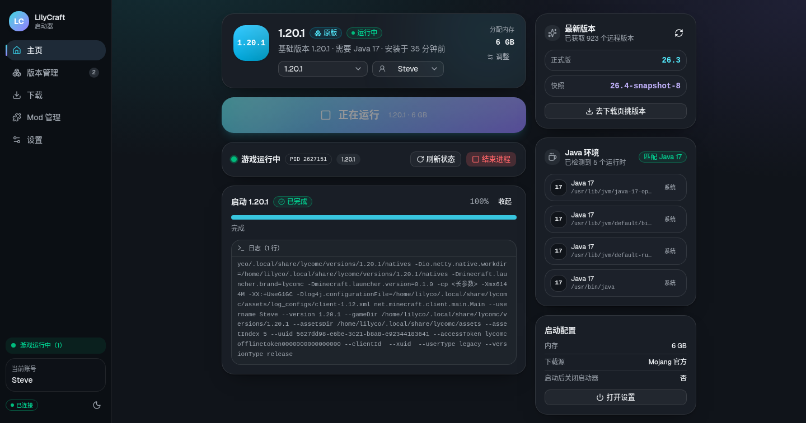
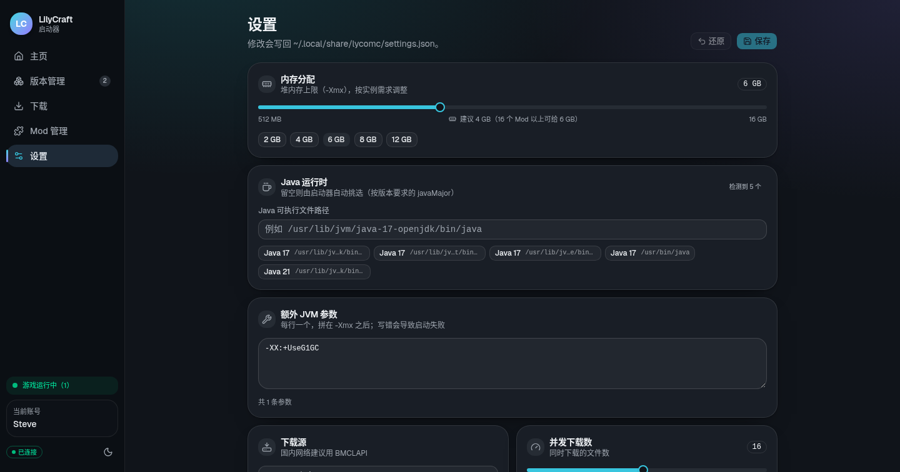

# lycomc —— 类 PCL 的 Minecraft 启动器

**lilyco 命令面（CLI / TUI / MCP / Web 四端）+ shadcn UI Web 控制台**，内核用 Rust 从零实现。

**Web 优先**：一个二进制默认启动本地 Web 控制台；原生桌面窗口降级为显式 `desktop` Cargo feature。五种用法共用同一份内核与同一份配置（`~/.local/share/lycomc`）：

| 入口 | 形态 | 用途 |
|---|---|---|
| `lycomc`（双击 / 裸跑） | 本地 Web 控制台（PCL 风界面） | **主入口**：自动打开浏览器，点按钮装版本、启动、管 Mod；无需懂端口与 IP |
| `lycomc --web` | 本地 Web 控制台 | 兼容旧用法，等价于裸跑 |
| `lycomc --desktop` | 可选原生桌面窗口 | 仅 `--features desktop` 构建可用；窗口、托盘、快捷方式，默认不编译 GTK / WebView |
| `lycomc <子命令>` | CLI | 脚本 / 终端用户，14 个子命令 |
| `lycomc --tui` | 终端全屏界面 | 无浏览器的机器上选命令、填参数、看结果（需真 TTY） |
| `lycomc --mcp` | MCP 服务器 | 交给 AI Agent 调用（写操作走白名单策略） |

## 实测跑通的链路（真实网络 / 真实 JVM / 真实渲染）

- **原版安装**：`lycomc install --version 1.20.1` → 3600 个文件 / 623.9 MB，含 assets 索引与 objects、88 个 libraries、natives 解压。
- **离线启动**：`lycomc launch --version-id 1.20.1 --account Steve` → 日志出现 `Setting user: Steve` / `LWJGL 3.3.1` / `Sound engine started` / 全套 atlas `Created`，即真进主菜单。
- **Fabric**：装 `fabric-loader-0.20.1-1.20.1`，启动日志 `Loading 59 mods:` + Sodium 生效。
- **Modrinth**：装 Sodium / Fabric API 到实例 `mods/`，列表可读、可删。
- **Web 全链路**：首页点「启动游戏」→ SSE 进度 + 日志尾 → 「游戏运行中 PID」→「结束进程」。
- **中文本地化**：`gameLang` 默认 `zh_cn`（启动前写入实例 `options.txt`）；「版本管理 → 一键汉化」异步装 CFPA 模组汉化包与 Sodium 中文包，游戏主菜单与 Mod 设置页均中文。汉化包仅运行时下载、不内嵌二进制。
- **国内镜像**：默认下载源 bmcl（设置页可切回 Mojang 官方），BMCLAPI 覆盖版本清单/JSON/libraries/assets/Fabric meta 与 maven 库；Modrinth 搜索与文件优先 MCIM 中国镜像；托管 JRE 优先清华 TUNA；CFPA 汉化包经 gh-proxy.com / ghfast.top / hk.gh-proxy.com 多级回落。所有请求统一 UA lycomc/0.1，主源失败自动回落官方，实测各端点均 200。

> 唯一已知无害报错：`UnsatisfiedLinkError: libflite.so`（Narrator 语音库，系统未装，不影响游戏）。

## 快速开始

```bash
# 构建（前端产物会被 include_dir! 编进二进制，所以先建前端）
cd web && pnpm install && pnpm build
cd .. && cargo build --release                 # 默认 Web 构建，不链接系统 WebView
# 可选桌面壳：cargo build --release --features desktop
# 产物：~/.cache/lilyco-build/target/release/lycomc（cargo config 把 target-dir 指到了 ~/.cache）

lycomc                      # 起 Web 控制台（默认 http://127.0.0.1:8766，自动开浏览器）
lycomc --desktop            # 仅 desktop feature 构建可用：原生窗口；否则提示后回落 Web
lycomc install --version 1.20.1
lycomc launch  --version-id 1.20.1 --account Steve
lycomc launch  --version-id 1.20.1 --account Steve --server mc.hypixel.net  # 本次直连服务器
lycomc list                 # 已装实例
lycomc javas                # 系统 Java 探测
lycomc mod-search --query sodium --version-id 1.20.1
lycomc --schema             # 全部命令的 JSON 清单（给脚本 / Agent 看）
# Web 控制台：版本管理页点「一键汉化」，设置页选「游戏语言」/「默认直连服务器」，主页启动区填「直连服务器」
```

> **一键直连多人服务器**：主页「直连服务器」填 `mc.hypixel.net` 或 `mc.hypixel.net:25565` 再点「启动游戏」即可直接进入该服务器；留空正常进主菜单。设置页「默认直连服务器」会记住常用地址，主页本次填写的值覆盖它（显式清空只影响本次启动，不改写默认值）。CLI 对应 `--server <地址>`。地址只接受域名 / IP / 端口常见字符；仅 MC 1.20+ 且版本元数据带 quickPlay 规则时生效，旧版本不会追加未知参数。

> **实机联机补证**：已用 e45976b 默认二进制在隔离数据目录启动本机 1.20.1 独立服务端（online-mode=false、离线账号 Steve），通过 Web API 的 server=127.0.0.1:25565 让真实客户端直连；服务端日志出现 Steve joined the game，并留存「Minecraft 1.20.1 - 多人游戏（第三方服务器）」进服截图。此项只补验收证据，不改变 API / 命令 / UI，详见 docs/TEST-REPORT.md §11 与 docs/TEST-EVIDENCE.json 第 10 组。

最小开箱验收：`bash scripts/smoke-web.sh`（临时数据目录，不打开浏览器、不碰真实账号与版本）；完整维护检查：`bash scripts/check.sh`（双轨检查后自动恢复默认 Web 二进制）。

环境变量：`LYCOMC_PORT`（Web 端口，默认 8766）、`LYCOMC_NO_OPEN=1`（不自动开浏览器）、`LYCOMC_DATA_DIR`（数据根）、`LILYCO_UI=web|gui|desktop`（入口覆盖；`desktop` 仅在启用 feature 时真正打开窗口）。

> **本机 Web 可执行程序**：默认入口编译成 Linux ELF / Windows `.exe` / macOS 二进制后，双击都会启动本地 Web 控制台并自动打开系统默认浏览器；Linux 用 `xdg-open`，Windows 用 `rundll32 url.dll,FileProtocolHandler`，macOS 用 `open`，`LYCOMC_NO_OPEN=1` 可关闭。Windows `.exe` 需要 Windows 工具链或 CI 产出，本机缺 MSVC `lib.exe`，不在此宣称已出包。

## 界面

| 主页 | 运行中 |
|---|---|
|  |  |
| **版本管理** | **下载** |
|  |  |
| **Mod 管理** | **设置** |
|  |  |

真实启动进主菜单（原版 1.20.1）：


中文本地化实测（Fabric 1.20.1 + Sodium，游戏内截图）：

| 中文主菜单 | 中文选项页 | 中文 Mod 设置页（Sodium） |
|---|---|---|
|  |  |  |

## 六个页面

- **主页**：大型启动按钮（PCL 风）、实例卡、分配内存、运行中 PID + 结束进程、SSE 实时进度与日志尾、远程最新版、Java 状态，以及来自 `/api/state` 的真实快照图表（recharts 饼图 / 柱状图）。
- **版本管理**：已装实例列表、切换当前实例、删除、看详情（Mod 数 / 运行中）、一键汉化（已汉化显示徽章）。
- **下载**：远程 900+ 版本（正式版 / 快照 / 全部）、搜索、分页、一键安装（可同时装 Fabric）。
- **Mod 管理**：Modrinth 搜索（400ms 去抖）+ 一键装（自动拉依赖）+ 已装列表删除。
- **设置**：内存滑块、Java 运行时选择、额外 JVM 参数、下载源（Mojang 官方 / BMCLAPI 国内镜像，默认 BMCLAPI）、并发数、关闭行为、游戏语言（默认简体中文）、离线账号。
- **使用教程 `#/guide`**：四步图文 + 三条 FAQ，全中文、无术语，随时可从顶栏或侧栏回到这里。

## 可选桌面壳（feature，不是主入口）

```bash
cargo build --release --features desktop     # 显式编译，才链接 wry / GTK / 托盘依赖
lycomc --desktop                             # 或 LILYCO_UI=desktop：打开 LilyCraft 原生窗口
lycomc                                      # 默认仍是 Web 控制台，自动开浏览器
```

- **Web 优先**：裸跑、`--web`、`--gui`、CLI、`--tui`、`--mcp` 都不需要桌面依赖；默认构建不编译 `src/desktop.rs`，不链接 GTK / WebView2 / WKWebView。未启用 feature 时传 `--desktop` 会打印提示并回落 Web，不会报错。
- **零术语首启向导 / 教程**：同一套 Web UI 在浏览器与桌面窗口里共用；第一次打开是三步引导（认识它 / 取个名字 / 选个版本），`#/guide` 是四步图文 + 三条 FAQ，顶栏问号与侧栏「使用教程」都能进。
- **窗口与托盘**（仅 desktop feature）：1180x780 起，缩放跟随；关窗最小化到托盘，菜单有「打开主界面 / 使用教程 / 退出 LilyCraft」。
- **快捷方式**（仅 desktop feature）：Linux 显式运行 `--desktop` 时生成应用菜单项、图标和桌面图标；`Exec` 带 `--desktop`，确保双击进的是原生窗口而不是 Web 控制台。
- **维护边界**：桌面壳的历史输入焦点问题在本轮冻结，不再作为 Web 主线的 P0；它保留为可编译 feature，后续可单独维护。

## 多平台

| 平台 | 形态 | 状态 |
|---|---|---|
| Linux / Windows / macOS | 浏览器 + 本地 Web 服务（PWA） | ✅ Web 优先主形态；同一份 `web/dist` 与 axum 内核，用户只需浏览器 |
| Linux | 可选桌面窗口 / deb / AppImage | 🟡 `--features desktop` 曾实机验过窗口、缩放、托盘、关窗最小化、快捷方式；现降为 feature，不再作为默认入口 |
| Windows | 可选桌面窗口 / NSIS 安装器 | 🟡 同一份 `src/desktop.rs` 源码 + 工作流；本机无 MSVC `lib.exe`，未产出已签名 .exe |
| macOS | 可选桌面窗口 / .app + DMG | 🟡 同上，无 mac 实机与签名 |
| Android | Kotlin WebView 壳 + JNI 启动本地内核 | 🟡 `android/` 源码 + 工作流，仓库不含 APK；形态仍待用户确认 |
| 浏览器 | PWA（`manifest.webmanifest`，可添加到主屏幕） | ✅ 实测 manifest 正常返回 |

> 说明：Web 优先后，Windows / macOS / Android 的交付门槛是「浏览器能打开同一套 Web 控制台」，不再是原生安装包；wine 可跑 Web UI 或 exe，但都不是主线。Android 当前定位仍是**本地管理 / 教程 / 远程控制壳**，不在手机上直接跑 Java 版 MC。已签名安装包与四端实机验收都还没做，不在本文宣称已达成；m03957 的全平台实机演示需按新口径重新确认。
>
> m06729 补充：Windows `.exe` 也可以，但优先同一个「本机 Web 可执行程序」形态；它不是原生桌面客户端，双击后起本地服务并自动开浏览器。源码已补 Win32 默认浏览器分支，出包需 Windows 工具链 / CI。

打包与构建：

```bash
bash scripts/package-front.sh        # 先建前端产物
cargo packager --release -c packaging/Packager.toml   # 需 cargo install cargo-packager
bash scripts/build-android.sh        # 需 Android SDK + NDK + cargo-ndk + Gradle

> `packaging/Packager.toml` 的 `beforePackagingCommand` 会显式带 `--features desktop`；默认 `cargo build` 不带桌面依赖。
```

CI 见 `.github/workflows/release.yml`（手动触发，只上传 artifact，不建 Release、不打 tag）。

## 架构

```
src/
  main.rs      入口分发：无参数 / --web / --gui → Web 控制台（默认）；--desktop → 可选桌面壳；子命令 → CLI；--tui / --mcp → lilyco
  lib.rs       rlib + cdylib 门面；desktop 模块由 feature 门控，含 start_embedded() 与 Android JNI 入口
  desktop.rs   可选原生窗口（wry）+ 托盘 + 自绘图标 + Linux 快捷方式；默认构建不编译
  commands.rs  lilyco 命令注册表（14 个命令，CLI/TUI/MCP/Web 共用同一份）
  policy.rs    安全策略：本地面放行 T0/T1；MCP 面写操作仅白名单
  api.rs       axum REST + SSE + 内嵌前端静态资源（fallback）
  jobs.rs      任务表 + broadcast 事件流
  settings.rs  配置与离线账号持久化
  mc/          MC 内核（与前端完全解耦）
    meta.rs      版本 JSON 解析、规则求值、参数拼装
    install.rs   库/资源下载计划、natives 解压、版本合并
    download.rs  并发下载 + 进度泵 + 哈希校验
    fabric.rs    Fabric loader 元数据与合并
    launch.rs    参数拼装、natives 补齐、子进程与日志
    java.rs      Java 探测与托管 JRE 下载（Adoptium / 清华 TUNA 优先）
    modrinth.rs  Modrinth 搜索 / 安装 / 删除（MCIM 镜像回落）
    options.rs   options.txt 原子改写（lang / resourcePacks）
    localize.rs  一键汉化：CFPA + Sodium 资源包下载、pack_format 兼容重写
web/          React 19 + shadcn/ui + Tailwind 4 + hash 路由，构建产物被 include_dir! 编进二进制
```

**关键设计**：Rust 只依赖 `lilyco` facade，不直接依赖 `lilyco-*`；前端不打包成独立站点，而是编进二进制（单文件分发，`/api/*` 与静态资源同一个 axum 服务）。

## 文档

- [docs/DECISION.md](docs/DECISION.md) —— lyco 预研：候选对比、niche 知识、自研薄壳，以及 Web 优先 / NSH 观察项决策
- [docs/TEST-REPORT.md](docs/TEST-REPORT.md) —— 逐轮测试记录与平台达成矩阵（§7 桌面壳历史、§8 Web 优先回归）
- [docs/CONTRACT.md](docs/CONTRACT.md) —— 前后端契约（HTTP API、类型、数据根布局、变更记录）
- [docs/DECISION.md](docs/DECISION.md) 末节 —— 本地化 / 镜像源调研、接入决策与许可说明（CFPA 包 CC BY-NC-SA 4.0、Sodium 中文包 MIT）；本项目二进制不含第三方汉化资源，用户点「一键汉化」时自行下载。国内镜像决策：adopt 现状 + 局部补齐，CurseForge 完整接入 / Forge·NeoForge·OptiFine 安装器 / 自搭反代 ROI 未过门槛暂不做。

## 开发与维护边界

本仓库当前把 `lilyco` 依赖写成绝对路径（`/home/lilyco/code/lilyco/lilyco`），因此定位为**本机开发仓库**，不提供公共 CI：

```bash
# 需要 pnpm 9+；前端产物会被 include_dir! 编进二进制
./scripts/check.sh
```

本地检查包含 `pnpm lint`、前端构建、`cargo fmt --check`、`cargo clippy -D warnings`、`cargo test`，并额外用 `--features desktop` 再跑一轮 clippy / test / build（`scripts/check.sh` 双轨守卫）。`.github/workflows/release.yml` 是为多平台出包准备的**手动**工作流，同样受这条限制：要让它在公共 runner 上真正跑通，需要先把 `Cargo.toml` 的 `lilyco` 依赖改成可复现的 git rev 或发布包，并在 CI 中检出对应源码（当前 Rust 检查步骤带 `|| true` 就是为了不误报）。

## License

个人项目，未指定。
